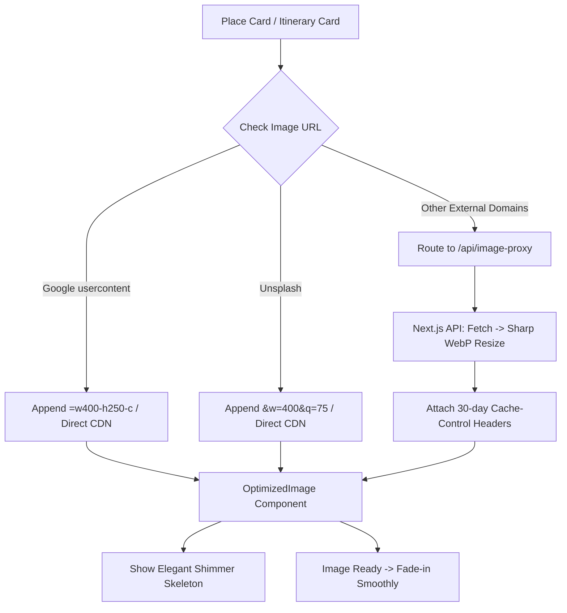

# Design Document: Fast Place Cover Images Optimization (Hybrid Image Proxy & Lazy Loading)

## 1. Background & Problem Statement
ผู้ใช้พบปัญหาความช้าขณะโหลดหน้าเว็บและดูสถานที่ท่องเที่ยว โดยเฉพาะส่วนของ **"รูปภาพหน้าปกของการ์ดสถานที่ (Cover Images)"** ที่ดาวน์โหลดช้าและแสดงผลช้า
จากการตรวจสอบโค้ดพบสาเหตุดังนี้:
1. **ภาพขนาดใหญ่เกินความจำเป็น (Uncompressed / Full Resolution):** รูปภาพสถานที่ที่ดึงมาจาก Google Maps (`lh*.googleusercontent.com`), DuckDuckGo, หรือ Wikimedia Commons ไม่ได้ถูกจำกัดขนาดไฟล์ บางรูปมีขนาด 2MB - 8MB ทำให้การ์ดแต่ละใบต้องโหลดภาพขนาดเต็ม
2. **ไม่มี Lazy Loading & Async Decoding:** การ์ดสถานที่ในลิสต์และแผนการเดินทางใช้แท็ก `` ธรรมดา ทำให้เบราว์เซอร์ส่งคำขอ HTTP พร้อมกันหลายสิบรายการ แย่ง Bandwidth กันจนกระตุก
3. **ไม่มี Loading Skeleton สำหรับรูปภาพ:** ขณะที่รูปกำลังโหลด การ์ดจะแสดงเป็นกล่องว่าง หรือเกิด Layout Shift จนกว่ารูปจะมา
4. **ขาดระบบ CDN / Browser Caching ที่เหมาะสม:** รูปภาพภายนอกบางแหล่งไม่มี Cache-Control headers ที่ยาวนาน ทำให้ต้องดาวน์โหลดใหม่ซ้ำๆ

---

## 2. Architecture & Design Decisions

### A. Hybrid Image Optimization Strategy
เราเลือกใช้สถาปัตยกรรมแบบ **Hybrid** เพื่อความเร็วสูงสุดและใช้ทรัพยากรเซิร์ฟเวอร์น้อยที่สุด:

1. **Tier 1: Direct CDN URL Rewriting (0ms Server Overhead)**
   - **Google Maps Photos (`lh*.googleusercontent.com`):** ปรับแต่ง URL โดยตัดพารามิเตอร์เดิมออกและเติม `=w400-h250-c` (สำหรับ thumbnail) หรือ `=w800` (สำหรับ modal) ทำให้ Google Global Edge CDN ทำการย่อขนาดและแปลงเป็น WebP อัตโนมัติในระดับ 10-30KB ตอบกลับภายใน 20-50ms
   - **Unsplash Images (`images.unsplash.com`):** เพิ่มพารามิเตอร์ `&auto=format&fit=crop&w=400&q=75` ให้ Unsplash Imgix CDN ย่อขนาดและบีบอัดเป็น WebP ทันที

2. **Tier 2: Backend Image Proxy with Sharp (`/api/image-proxy`)**
   - สำหรับรูปภาพจากแหล่งอื่นๆ เช่น Wikimedia Commons, DuckDuckGo, หรือลิงก์ที่ผู้ใช้กรอกเอง:
   - Client เรียกผ่าน `/api/image-proxy?url=<encoded_url>&w=400&q=75`
   - Server ดึงรูปภาพ แปลงและย่อขนาดด้วย `sharp` เป็น WebP ขนาดกะทัดรัด
   - แนบ Header แคชระดับ Production:
     `Cache-Control: public, max-age=604800, s-maxage=2592000, stale-while-revalidate=86400`
     ทำให้ทั้ง Vercel Edge Cache และเบราว์เซอร์ไม่ต้องดาวน์โหลดรูปซ้ำอีกตลอด 30 วัน
   - หาก Sharp ประสบปัญหา จะ Fallback สตรีมภาพเดิมพร้อมแคชอย่างปลอดภัย ไม่ให้หน้าเว็บพัง

3. **Tier 3: Frontend Lazy Loading & Shimmer Skeleton UI**
   - สร้าง Component / Wrapper `OptimizedImage`:
     - เพิ่ม `loading="lazy"` และ `decoding="async"`
     - แสดง **Shimmer Skeleton (สีเทาอ่อนหรูหราแบบ Glassmorphic)** ระหว่างที่รูปกำลังโหลด
     - เมื่อโหลดเสร็จ (`onLoad`) จะมีแอนิเมชัน **Fade-in (`opacity: 0` -> `opacity: 1`) ภายใน 0.3s**
     - Fallback อัจฉริยะแบบ 3 ลำดับเมื่อโหลดรูปไม่สำเร็จ: Custom Image -> City Default Cover -> Inline SVG Fallback

---

## 3. Component & Data Flow

---

## 4. UI/UX Changes
1. **Sidebar Place List (`.lm-card .lm-cover-strip`):**
   - รูปภาพแสดงผลทันทีด้วย WebP thumbnail ขนาดเล็ก โหลดเร็วขึ้น 5-10 เท่า
   - มี Shimmer skeleton ขณะกำลังดาวน์โหลดรูปภาพ
2. **Itinerary Daily Cards (`.day-place-card`):**
   - แสดงรูปขนาดย่อม 160-200px สวยงาม ไม่กระตุก
3. **Place Detail Modal Header (`.place-detail-modal`):**
   - ขอรูปขนาดชัดขึ้น (`w=800`) พร้อม Fade-in สบายตา
4. **Photo Selection Modal (`.edit-modal`):**
   - รูปผลการค้นหาจาก Wikimedia/DDG โหลดผ่าน Proxy ย่อขนาดเป็น WebP ช่วยให้เลือกรูปได้ลื่นไหล ไม่ค้าง

---

## 5. Verification Plan
- ทดสอบเปิดแท็บเมืองต่างๆ และตรวจสอบ Network Tab ว่ารูปภาพถูกดาวน์โหลดในฟอร์แมต WebP ขนาดไม่เกิน 20-50KB
- ตรวจสอบ Lazy loading เมื่อเลื่อน scroll ว่ารูปที่อยู่นอกหน้าจอจะไม่โหลดจนกว่าจะเลื่อนเข้ามาใกล้
- ตรวจสอบ Shimmer Skeleton และ Fade-in animation ว่าเนียนตาไม่มี Layout Shift
- รัน Unit test / Build check ให้ผ่าน 100%
